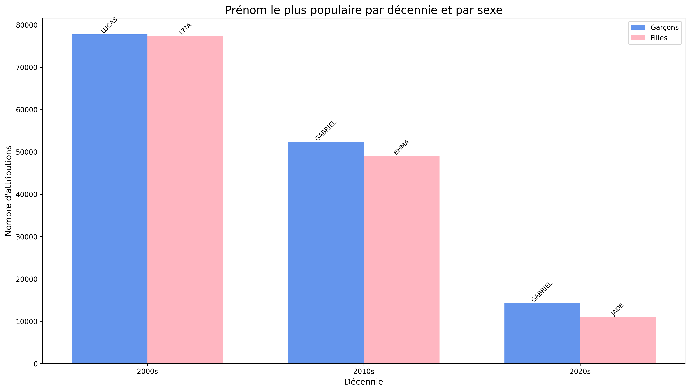

# Prénoms INSEE sur Hadoop

Les prénoms les plus donnés en France, par année et par sexe, calculés sur le fichier des naissances de l'INSEE avec Hadoop.



## Ce que fait le projet

1. **Validation** (`python3/validation.py`) : nettoie le CSV de l'INSEE et écarte les lignes anonymisées ou mal formées.
2. **MapReduce en Python** avec Hadoop Streaming :
   - `mapper.py` émet une clé `année_sexe_prénom` et le nombre de naissances ;
   - `reducer.py` additionne les naissances de chaque clé.
3. **Post-traitement** (`post-traitement.py`) : garde le top 5 par année et par sexe, puis produit `resultats.html` (tableau filtrable) et le graphique par décennie.
4. **Variante Pig** (`scripts/script.pig`) : le même calcul en Pig Latin, sur le fichier par département depuis 2000.

## Arborescence

| Dossier | Contenu |
|---|---|
| `python3/` | Version principale (Python 3) |
| `python2/` | Version pour la VM Hadoop en Python 2, avec son script de lancement |
| `variant1/` | Variante du mapper et du post-traitement |
| `scripts/` | Envoi des fichiers vers la VM, exécution, script Pig |

## Lancer en local, sans Hadoop

```bash
cat nat2022_valid.csv | python3 python3/mapper.py | sort | python3 python3/reducer.py | python3 python3/post-traitement.py
```

## Lancer sur la VM Hadoop

```bash
./scripts/telechargerVersVM_Linux.sh   # copie le CSV et les scripts sur la VM (SSH, port 2222)
./scripts/executer_depuis_vm.sh        # sur la VM : envoie le CSV dans HDFS et lance le script Pig
```

La version Hadoop Streaming en Python 2 se lance avec `python2/run_streamingP2.sh`.

Stack : Python, Hadoop Streaming, HDFS, Pig, matplotlib.
